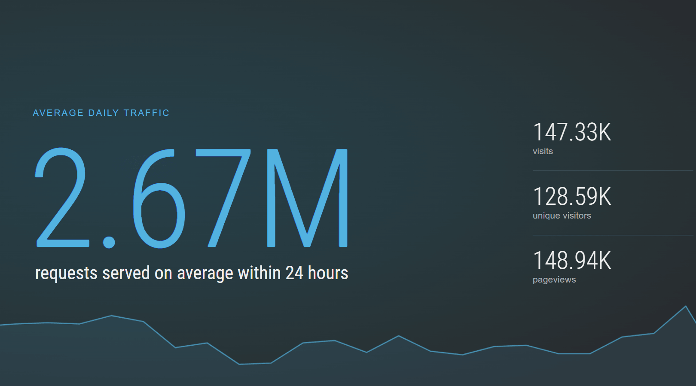
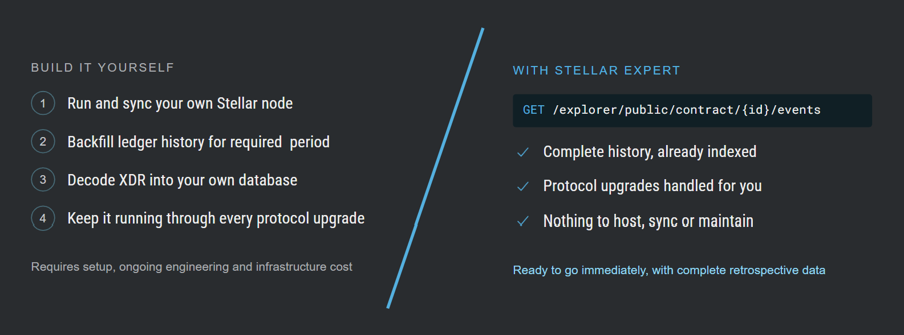
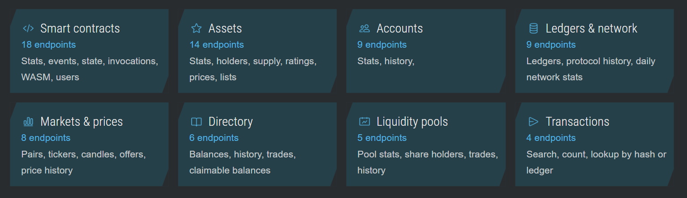
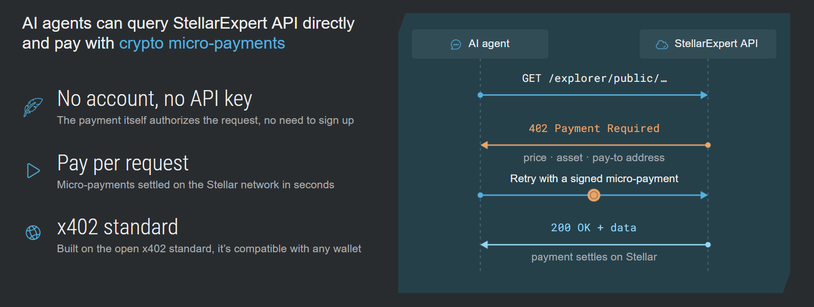
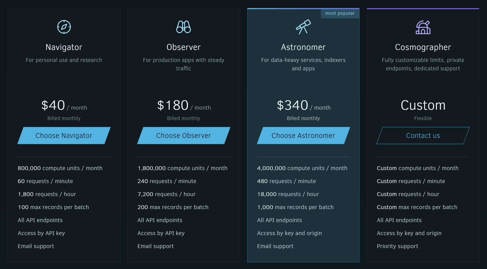
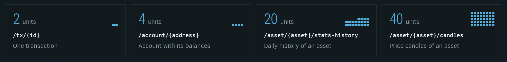

Open a Stellar wallet or your exchange account, choose any transaction, tap "view on explorer", and you will likely land
on StellarExpert. For nine years we've been turning the raw ledger into pages anyone can read, from a
first-time user checking a payment to a seasoned developer debugging a smart contract.

All this data is backed by API. Starting today that API is open to everyone as a subscription. With StellarExpert you will
have entire ledger at your fingertips – processed, stored, indexed, aggregated, and enriched. The same indexed data that
powers our explorer, now available for your own product.

## How we got here

StellarExpert went live in 2017 with a simple goal: make what happens on-chain understandable, even without a deep
technical background. Our index started at the very first ledger of 2015, so the explorer could show the network's full
history from day one.

Then the network kept growing, and so did we. To keep up, we rebuilt our data processing pipelines and storage almost
every two years. Today our infrastructure serves several million requests daily.



Along the way, StellarExpert became part of the ecosystem's daily routine. Most wallets and exchanges link to it as
their default explorer, and our public directory of known accounts and scam-domain blocklist helps protect users from
bad actors.

## Why subscriptions

Over the years, other teams started building their own products on the API that powers the explorer. That is exactly
what we hoped for. But serving everyone for free, and rebuilding the stack with every protocol era, is not something we
can keep up forever.

Subscriptions put that work on a sustainable footing. They also let us treat the API as a product in its own right:
documented, metered and supported, rather than a by-product of the explorer.

Of course, anybody can spin up an indexer or build a custom one. There is a publicly available toolkit that allows you
to work with historical data. But then you need to maintain it, pay for CPU and storage, keep all of it working through
every protocol upgrade. And what if the server with all the data suddenly dies, do you have a spare? That is a permanent
engineering and infrastructure cost. With StellarExpert it is as simple as it can be. Just build your app and we’ll take
care of the ledger data.



## What you get

Originally, we built this API for ourselves, and lately we've been polishing it for other developers. Every endpoint has
the OpenAPI specification, and the docs feature a playground to try requests live.
Responses follow the familiar Horizon list format, so Stellar ecosystem developers should feel themselves at home.

We have a data endpoint for every use case, all available with one API key. Whatever the explorer shows, the API can
deliver to you, plus some extra data not available in the interface.



Our index starts at the network's first ledger in 2015 and runs continuously to today. Transactions, accounts, assets,
trades, DEX offers and ledger statistics are all there. A typical Stellar RPC node keeps only seven days of history by
default. With StellarExpert you can query any account, asset or market at any point in time, not just the last few days.

### X-ray vision for contracts

For smart contract developers, our API offers a genuine X-ray vision.

- Live contract state, including temporary entries and entries that have already been archived, with their TTLs
- The complete indexed event history with full-text search on event topics
- Every invocation plus contract analytics
- WASM contra binaries, their version history
- Error codes, top contract users, balances, trading activity, and more

### Browser access without a key

Front-end apps can call the API straight from the browser. On Astronomer and Cosmographer plans, register your website
origin in the account dashboard (as `example.com` or `*.example.com` if you want to include subdomains).
Requests from your site are identified by the `Origin` header the browser sends, so your pages need no API
key and your key never ships to the client. Our server sends

All API keys and origins on an account share one compute-unit balance and one set of rate limits.

### Pay-per-request for AI agents

Of course, we didn't forget about our AI friends either. Agents can use the API with no account or key, paying per
request over the open [x402](https://github.com/coinbase/x402) protocol. The payment itself authorizes the request.



Point your agent at our OpenAPI docs and it can work out which
endpoint it needs. Accounts that have used up their compute credits can pay for single calls the same way.

### Proven track record

StellarExpert has run in production for nine years, and the whole ecosystem tests it every day.

- Indexed queries: queries run through distributed indexes, so heavy aggregations return in milliseconds
- High availability: independent servers in a failover configuration keep every data layer available
- Fast delivery: API responses are cached at the edge, static files are served from a CDN

Privacy is important, your call history shouldn't be someone's dataset. We don't process personal data and don't store
your exact requests history.

### Subscription plans

From weekend prototypes to mission-critical systems, there's a plan that fits, and you can upgrade at any time.
Choose a standard subscription and start building right away. Enterprises get flexible metering limits, dedicated
support and licensable data.



Yearly billing saves up to 30%. Prices include taxes already, and you can pay by card, PayPal, Apple Pay or Google Pay.
Check current plans on the [pricing page](https://stellar.expert/pricing).

Each paid endpoint has a price in compute units that depends on how much work the query does, and every paid operation
in the [API reference](https://stellar.expert/api-docs) shows its price. The allowance resets each billing month, and
unused units don't roll over. If you run out, paid endpoints respond `402` until the reset, while free endpoints and
Testnet keep working.



## What stays free

Only starting building on Stellar? We've got your back — all available API endpoints for Testnet data are free!
With or without an API key. Anonymous requests to Testnet and other free endpoints are limited to 30 per minute.
If you need a higher throughput, register an account to increase rate limits with your API subscription.

On Mainnet, endpoints marked **Free** in the [API reference](https://stellar.expert/api-docs) stay open to everyone,
with no plan limitations on page size. Today that list covers:

- The directory of known accounts and the scam-domain blocklist (`/explorer/directory/...`)
- Asset supply (`/explorer/{network}/asset/{asset}/supply`)
- The top 50 asset list (`/explorer/{network}/asset-list/top50`)
- Tickers (`/explorer/{network}/ticker/{symbol}`)
- Server info and the OpenAPI spec files

Every other `GET` endpoint for Mainnet data is paid.

## Key dates

- **November 5, 2026 (today):** subscriptions live. Pick a plan on the [pricing page](https://stellar.expert/pricing)
  and create an API key if you want to use our data in your application.
- **November 6, 2026, 15:00 UTC:** anonymous access ends. A paid endpoint called without a valid API key or registered
  origin responds `402 Payment Required`. Free endpoints and Testnet will keep working as before.

If your app, bot or backend calls `api.stellar.expert` without a key, you have time to add one. 
Testnet stays free, and so does browsing the stellar.expert explorer.

## Migrating your integration

Integrations that only call Testnet need no API key. For using paid data, just pass the `Authorization: Bearer <key>`
header.

```bash
curl -H "Authorization: Bearer $STELLAR_EXPERT_API_KEY" \
  "https://api.stellar.expert/explorer/public/account/GA..."
```

1. Pick a plan and create an API key.
2. Send the key in the `Authorization` header on every server-side request.
3. For browser apps, proxy calls through your backend, or register your site's origin on an Astronomer or Cosmographer
   plan to fetch the data directly from your website.

API v0.3 also changes a few response formats and deprecates several endpoints.
The [migration guide](https://gist.github.com/orbitlens/ea6986fdb653828846cb13ac6c2ef6ce) covers every change, with
before-and-after examples and a checklist.

## Start building

- Plans and prices: [stellar.expert/pricing](https://stellar.expert/pricing)
- API reference and live playground: [stellar.expert/api-docs](https://stellar.expert/api-docs)
- Migration guide for v0.3: [read on GitHub](https://gist.github.com/orbitlens/ea6986fdb653828846cb13ac6c2ef6ce)
- Questions, custom limits or data licensing: <info@stellar.expert>

We can't wait to see you reach the stars with what you build next!
