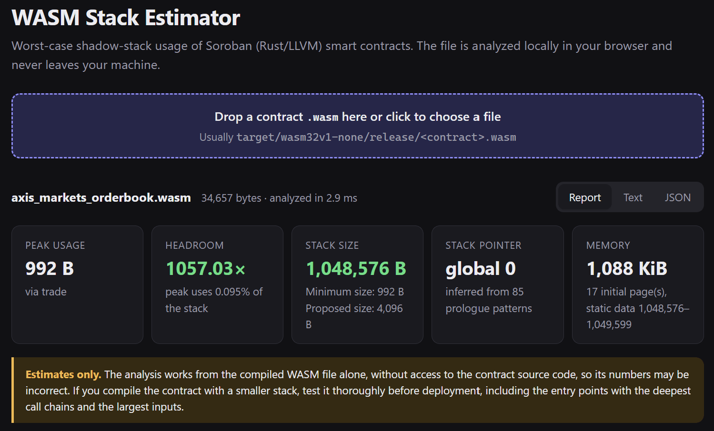
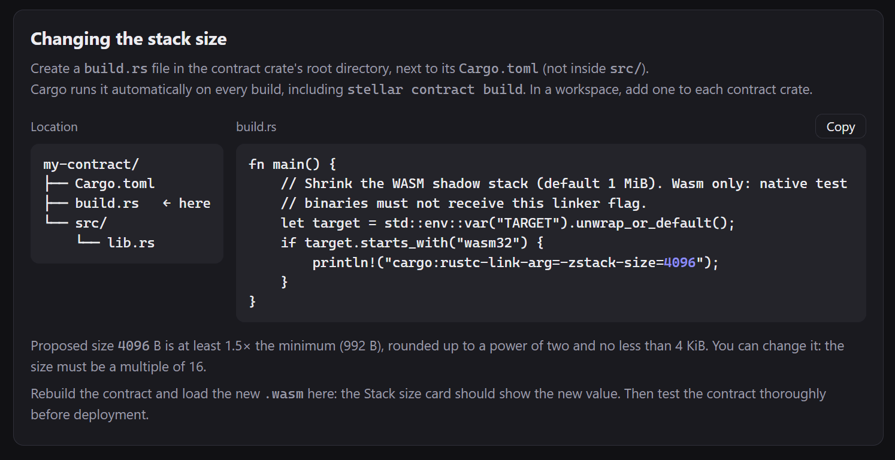
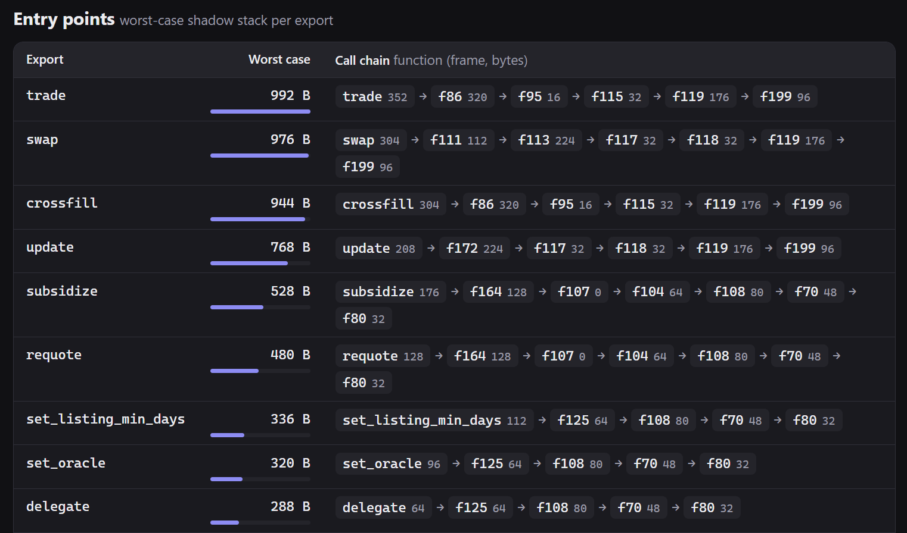

## Your Soroban contract reserves 1 MiB of stack. It probably needs less than 1 KiB.

Every Soroban contract compiled from Rust carries a stack it almost never uses. By default the Rust toolchain reserves
**1 MiB** of linear memory for it, and every invocation of the contract pays for that memory. We built a small tool,
**[WASM Stack Estimator](https://orbitlens.github.io/wasm-stack-estimator/)**, that reads a compiled contract and tells
you how much of that stack the contract can actually reach, and how to optimize memory usage.

It runs in the browser (drop a `.wasm` file, nothing is uploaded) and from the command line. Both are open source:
[github.com/orbitlens/wasm-stack-estimator](https://github.com/orbitlens/wasm-stack-estimator).

## The (truly) shadow stack

WebAssembly has its own value stack, managed by the VM, but it can only hold plain numbers. Anything that needs a memory
address goes elsewhere: structs passed by reference, fixed-size arrays, buffers of `Val`s that get handed to host
functions. LLVM puts all of that on a *shadow stack* inside the module's linear memory, and manages it with an ordinary
mutable global, `__stack_pointer`.

You can see it in the compiled code. A function that needs 96 bytes of stack starts and ends like this:

```wat
global.get $__stack_pointer   ;; read the stack pointer
i32.const 96
i32.sub                       ;; reserve 96 bytes
local.tee $frame
global.set $__stack_pointer
;; ... function body works with memory at $frame ...
local.get $frame
i32.const 96
i32.add
global.set $__stack_pointer   ;; release them on return
```

How big can that stack get? That is decided during linking. Rust's WebAssembly targets ask the linker for 1 MiB and put
the stack at the very start of linear memory, with static data after it. So even a tiny contract starts life with
17 memory pages: 16 pages (64 KiB each) of stack plus one for its data, 1,088 KiB in total.

## Why it matters on Soroban

Each Soroban invocation instantiates a fresh VM for the contract, with the module's full initial linear memory, and that
allocation is charged to the transaction's resource budget. Not only it limits the maximum number of subinvocations you
can make from your contract, it also means that users are paying resource fees for the memory that is never used.
A cross-contract call does it again for every contract in the chain. The 1 MiB stack is paid for on every call, whether
the code touches it or not.

And it almost never does. We ran the estimator on six real Soroban contracts. Four of them showed between 624 and 992
bytes of stack. The heaviest two, both with a large price-update routine, peaked at 8,464 bytes: still less than 1% of
the default reservation. With a 16 KiB stack, any of these contracts fits its stack and static data into a single
64 KiB memory page instead of 17 pages reserved by default.

The catch is that shrinking the stack needs a number you can trust. If the stack is too small, the contract traps on its
deepest call path, and that path may be one your tests never take.

The problem was first highlighted by the [Xoxno](https://xoxno.com/) developer, who reached out with the request to
reduce the memory allocation for the Reflector smart contract. He proposed to reduce the stack size with a compilation
flag, which lead to a more deep research. We had to be 100% sure that adjusting compilation parameters will not lead to
any problems with the contract invocation in the future. So here is a tool that checks what stack size is actually
required by your contract.

## What the estimator shows

Open the [web page](https://orbitlens.github.io/wasm-stack-estimator/) and drop in a build, usually
`target/wasm32v1-none/release/<contract>.wasm`. Analysis takes a few milliseconds and happens entirely in the browser.



The report starts with a row of summary cards:

- **Peak usage:** the worst-case stack usage over all exported functions, and which export reaches it.
- **Headroom:** configured stack size divided by peak usage. The contract above has 1,057 times more stack than it can
  use.
- **Stack size:** the configured size, plus the *minimum size* and a *proposed size*.
- **Stack pointer** and **Memory:** which global is the stack pointer, the initial memory pages, and where static
  data sits.



Below that, a **Changing the stack size** block gives you a ready `build.rs` with the proposed size already filled in
(more on that below). Then come the details:

- **Entry points:** every export with its worst-case usage and the call chain that produces it, each function annotated
  with its own frame size.
- **Functions by frame size:** the functions that reserve the most stack, with flags for anything that makes the
  estimate less certain.
- **Text** and **JSON** tabs with exactly the same output as the CLI, ready to copy or download.



## From the command line

The CLI is a single Node.js script with no dependencies (Node 18 or newer):

```bash
git clone https://github.com/orbitlens/wasm-stack-estimator
node wasm-stack-estimator/wasm-frames.js target/wasm32v1-none/release/my_contract.wasm
```

Here is the output for a price oracle contract that already runs with a reduced 16 KiB stack (shortened):

```
Stack pointer:   global 0 (inferred from 56 prologue patterns), initial value 16,384
Layout:          stack-first ✓ (overflow traps), stack size 16,384 B
Memory:          1 initial page(s) = 64 KiB, static data 16,384–16,832
Peak usage:      8,464 B via set_price
Headroom:        1.94× of configured stack

Entry points (exports), worst-case shadow stack:
  set_price                          8,464 B   set_price(8400) → f131(48) → f119(16)
  config                               320 B   config(208) → f54(80) → f60(32)
  estimate_retention_cost              320 B   estimate_retention_cost(112) → f149(32) → f148(176)
  price                                288 B   price(128) → f107(0) → f112(64) → f151(96)
  lastprice                            256 B   lastprice(96) → f107(0) → f112(64) → f151(96)
  ...

Functions by frame size (top 20 with a frame or hazard):
     frame    worst path  name
     8,400       8,464 B  set_price
       208         320 B  config
       176         176 B  f148
...
```

Each chain entry is `function(frame bytes)`. Here, one function dominates: `set_price` reserves 8,400 bytes for itself,
while every other entry point stays under 400 bytes. That kind of outlier is worth knowing about. It sets the stack size
for the whole contract, and a frame that large usually means a big local value, such as a fixed-size array, that may be
worth restructuring.

Release builds usually strip function names, which is why internal functions appear as `f131`. Building with
`strip = false` doesn't change the generated code, so you can analyze such a build to get readable names.

Useful flags:

| Flag        | What it does                                                               |
|-------------|----------------------------------------------------------------------------|
| `--top N`   | List the top N functions (default 20); `--all` lists every function        |
| `--explain` | Show the instructions behind repeated or unusual stack-pointer writes      |
| `--json`    | Machine-readable output                                                    |
| `--sp N`    | Use global N as the stack pointer instead of detecting it                  |

`--json` makes it easy to guard the stack size in CI. This fails the build when headroom drops below 1.5×, or when it
can't be computed at all:

```bash
node wasm-frames.js target/wasm32v1-none/release/my_contract.wasm --json | jq -e '.headroom >= 1.5'
```

The analysis code is a standalone ES module, so you can also call it from your own scripts:

```js
import {analyzeWasm} from './stack-analysis.js'

const report = analyzeWasm(wasmBytes)
console.log(report.peak.total, report.headroom)
```

## How it works

The estimator parses the WASM binary directly, without wabt or any other toolchain, and then:

1. **Finds the stack pointer**, either by name (`__stack_pointer`, when a name section is present) or as the global
   that appears most often in the prologue pattern shown above.
2. **Measures each function's frame**: the largest constant it subtracts from the stack pointer.
3. **Builds the call graph** from direct calls. Indirect calls are matched to every table function with the same
   signature.
4. **Finds the deepest path** from every exported function, adding up frames along the way.

Calls to Soroban host functions cost nothing here: the host runs them natively, so they don't use the contract's shadow
stack.

Some code makes the bound inexact, and the tool flags it instead of guessing. Recursion makes a path unbounded (shown as
`∞`). Code that moves the stack pointer by a run-time amount turns the total into a lower bound (shown as `≥`). In both
cases the page won't propose a stack size.

## Shrinking the stack

`stellar contract build` has no stack-size option. The size is a linker argument, and the most reliable way to pass it
is a build script. Create `build.rs` in the contract crate's root, next to `Cargo.toml`:

```rust
fn main() {
    // shrink the WASM shadow stack (default 1 MiB)
    // wasm only: native test binaries must not receive this linker flag
    let target = std::env::var("TARGET").unwrap_or_default();
    if target.starts_with("wasm32") {
        println!("cargo:rustc-link-arg=-zstack-size=16384"); // adjust this value
    }
}
```

Cargo runs it on every build, including `stellar contract build`, and each contract in a workspace can have its own
size. You could also put the flag in `.cargo/config.toml` as target `rustflags`, but those take precedence over the
variable `stellar contract build` uses to add `--remap-path-prefix` for reproducible builds, so that flag is silently
dropped. The build script avoids the problem.

Which size to pick? The web page proposes one: at least 1.5 times the minimum, rounded up to a power of two, and never
less than 4 KiB. For the oracle above, that is 16,384 bytes. For a contract with a peak usage at 720 bytes, it is 4,096.
Since memory comes in 64 KiB pages, going much lower doesn't save anything more.

After rebuilding, run the estimator on the new `.wasm`. The Stack size card (or the `Layout` line in the CLI) should
show the new value. If it still stays > 1MB, the flag didn't reach the linker.

## A word of caution

The estimator works from the compiled WASM alone, without access to the contract source code, so its numbers are
estimates and may be incorrect. It assumes every call in the code can actually happen, which usually errs on the safe
side, but it can't account for code paths it doesn't recognize.

So treat the result as a well-informed starting point, not as proof. If you compile a contract with a smaller stack,
test it thoroughly before deployment. Native unit tests won't help here: they don't run on the WASM stack at all. Run
your tests against the built `.wasm` (for example by loading it with `contractimport!` and `env.register`, or by
invoking it on a local network or testnet). Cover every entry point, especially the ones with the deepest call chains,
with the largest inputs the contract accepts.

## Try it

- Web: **[orbitlens.github.io/wasm-stack-estimator](https://orbitlens.github.io/wasm-stack-estimator/)**
- Source and CLI: **[github.com/orbitlens/wasm-stack-estimator](https://github.com/orbitlens/wasm-stack-estimator)**

Drop in your contract and see how much of that megabyte it really needs. Issues and pull requests are welcome.
